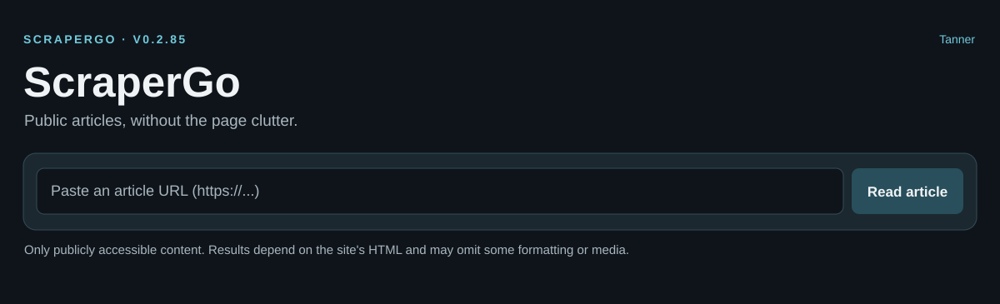

# ScraperGo



*ScraperGo's browser reading interface (illustrative preview).*

ScraperGo is a Go web-based clean article reader. Give it an article URL to extract readable text, headline, byline, inline links and editorial images into a simplified browser reading view. It distinguishes articles from many homepages/indexes, resolves supported Google News links, retains usable public previews where access policy permits, and offers image metadata, image delivery, classification and thumbnail APIs. Publisher restrictions and extraction limits remain in force; ScraperGo does not bypass paywalls.

## Requirements and running

Build from source with Go compatible with [go.mod](go.mod) (use the version specified in the file) and Git:

```bash
git clone https://github.com/richard-mauri/scrapergo.git
cd scrapergo
go test -count=1 ./...
go run . --port 8083
```

The default port without `--port` or `PORT` is 8080; the command-line flag overrides `PORT`. For a local macOS build use `./devbuild.sh` to create Intel and Apple Silicon binaries under `dist/` and checksums. The repository's `./scrapergo.sh` is **machine-specific**: it launches an Intel build at localhost:8083 plus a separately configured Cloudflare tunnel. It expects private local paths/tunnel credentials and is not a universal installation script. `./devbuild.sh --release` publishes a release; do not use it for normal builds.

Open http://localhost:8083/ after starting on that port; use the page to submit an article URL. For a Safari right-click link workflow, see [Safari extension setup](safari-extension/README.md). The temporary extension can target local or an independently reachable trusted HTTPS instance and reuses the reader tab.

## HTTP API

These routes are registered in [internal/app/server.go](internal/app/server.go); read, image-metadata and classification accept JSON. Examples below assume the server is running locally at 8083.

```bash
curl -sS -X POST http://localhost:8083/api/read \
  -H 'Content-Type: application/json' \
  -d '{"url":"https://example.com/article"}'

curl -sS -X POST http://localhost:8083/api/image-metadata \
  -H 'Content-Type: application/json' \
  -d '{"url":"https://example.com/article"}'

curl -sS -X POST http://localhost:8083/api/classify \
  -H 'Content-Type: application/json' \
  -d '{"url":"https://example.com/article"}'

curl -sS 'http://localhost:8083/api/article-image?url=https%3A%2F%2Fexample.com%2Farticle'
curl -sS 'http://localhost:8083/api/thumbnail?url=https%3A%2F%2Fexample.com%2Farticle&width=256' -o thumbnail.jpg
```

`POST /api/read` returns a normalized article JSON document or structured error; request body is limited to 4096 bytes. `POST /api/image-metadata` uses that same read path and returns `url`, `imageUrl`, `imagePresent` and ordered `imageCandidates`. `POST /api/classify` returns `classification`, `readableArticle`, `reason` and `imageAvailable` as appropriate; unknown/unavailable does not mean verified unreadable. `GET /api/article-image` serves a selected image; `GET /api/thumbnail` creates a cached, cropped JPEG (width subject to server validation).

Two developer diagnostics, `POST /api/diagnostic/extract` (requires `{"url":"...","html":"..."}`) and `POST /api/diagnostic/image-trace` (accepts `{"url":"..."}` and optional `html`), are **direct-loopback-only**, not public APIs. Keep them inaccessible to remote clients, including via any proxy that rewrites the apparent peer to loopback.

## Standalone extraction diagnostics

For extraction debugging without running the UI, use `go run ./cmd/htmlcapture` to save permitted publisher HTML through ScraperGo's validated fetcher, then `go run ./cmd/readabilityprobe` to compare source tags with Readability's HTML and text representations. These opt-in commands are separate from the production reader, and routine CI exercises reproducible synthetic fixtures rather than fetching live publishers. See [diagnostic commands and examples](cmd/readabilityprobe/README.md).

Development fixes must generalize across publishers and article shapes; preserve HTML-backed heading/time structure rather than relying on one site's URL or text patterns. See the [architecture contract](ARCHITECTURE.md) and [general-purpose acceptance gate](DEVELOPMENT.md#general-purpose-fix-acceptance-gate).

## Persistent recovery diagnostics (opt-in)

The normal Mac `./scrapergo.sh` launcher enables lightweight extraction-recovery tracing via `SCRAPERGO_RECOVERY_TRACE=1`. The process starts in the project root, so observations append to **`/Users/richardmauri/projects/scrapergo/diagnostics/recovery.jsonl`**. This entire `diagnostics/` directory is Git-ignored; it survives a build, process restart, and movement between Homepage, NewsGo and ScraperGo. The collector remains off when launching the executable directly without that environment variable. It records one observation per extraction attempt, not per browser navigation without an extraction request.

Each record contains UTC time, publisher hostname, a stable keyed article identifier, build label, extraction method, final counts, and per-stage `not_reached`, `executed_unchanged`, `modified` or `fallback_selected` status. It **does not** contain article text, full URLs, query strings, or tokens. The private `diagnostics/.recovery-key` file is used to maintain stable article IDs. Do not remove it unless intentionally starting a new distinct-article count. No trace data are uploaded by ScraperGo.

To summarize the accumulated records across sessions, from the repository root run `go run ./cmd/recoveryreport`. This prints total requests, distinct articles and publishers, and stage counts. To stop collection, start the server without `SCRAPERGO_RECOVERY_TRACE=1` (or remove the setting in `scrapergo.sh`). Existing observations are never reset automatically. Tracing is observational: a stage change does not prove its contribution survives final normalization or that removal would be safe. Use targeted regression tests before deleting recovery code.

## Restrictions and limitations

Network article retrieval enforces public HTTP(S) URL and redirect restrictions to mitigate SSRF; some Google News and publisher URLs cannot be resolved. Subscriber-only, blocked, script-heavy, dynamically loaded or non-article pages may yield an error, public preview or incomplete text. Image availability, portrait versus editorial-role classification, and live-page compatibility vary by source. Retrieval and rendering are not a substitute for permission to view the original content. The synthetic regression fixtures do not establish coverage of all live publisher pages.

## Extraction performance checks

`./devbuild.sh` already runs the Go tests and now also runs a short, threshold-free extraction benchmark smoke check before producing the macOS binaries. To collect repeatable timing and allocation measurements separately, use `./benchmark.sh` (five runs). Ordinary `go test ./...` does not run benchmarks; benchmark timings are informational, while execution errors fail the smoke check. See [extraction benchmark guidance](docs/extraction-benchmark-114.md).

## Project references

[Architecture contract](ARCHITECTURE.md) · [Development and PR workflow](DEVELOPMENT.md) · [Agent instructions](AGENTS.md) · [Repository layout](docs/repository-layout.md) · [Extraction fixtures](docs/extraction-fixtures.md).

## Optional suite administrator activity telemetry (Issue #131, merged)

ScraperGo can optionally send **aggregate, advisory activity snapshots** to Homepage's admin-only activity monitor. Set both `SCRAPERGO_ACTIVITY_URL` to the Homepage `/api/admin/activity/ingest` URL and `HOMEPAGE_ACTIVITY_KEY_SCRAPERGO` to a unique, private server-only key of at least 32 characters. The Homepage collector must be configured with the same private key for the `scrapergo` service. No browser script is enabled and no telemetry is sent when either variable is absent; invalid configurations disable reporting. Use HTTPS or explicit loopback HTTP only, and never put the key in browser JavaScript, URLs, Git, log output or account settings.

With telemetry enabled, the browser submits a random tab-scoped presence identifier plus visibility/interaction hints to its own same-origin `/api/activity/ping`. The server counts active observed tabs over 2/5/15/60-minute windows and concurrent HTTP work for article reading, classification, PDF, thumbnails, image delivery, diagnostics and metadata. Once a minute it reports **only aggregated counts**, using server-side authorization and replay protection, to Homepage. No publisher URL, article text, image URL, account identity, Homepage session token or raw tab identifier leaves ScraperGo as telemetry. Merged session-aware reporting verifies Homepage named/guest identity server-side and deduplicates parent sessions; a revoked bearer returns 401 and a verification outage 503. Presence is advisory, not a reliable unique-person count or authorization to restart services.

For isolated acceptance, use a detached worktree of `origin/feat/131-suite-activity`, build with `go test -count=1 ./...` and `go build -o "$SCRAPER_CHECKOUT/scrapergo" .`, then start the test binary with `--port 8088` and explicit `SCRAPERGO_ACTIVITY_TEST_LISTEN=127.0.0.1:8088`, which restricts only the disposable candidate to loopback. Set `SCRAPERGO_ACTIVITY_URL=http://127.0.0.1:8788/api/admin/activity/ingest` and a fresh `HOMEPAGE_ACTIVITY_KEY_SCRAPERGO` shared privately with the separate disposable Homepage instance started with `SUITE_DATA_DIR="$TEST_ROOT/data"` and `LISTEN_ADDR=127.0.0.1:8788`. Do not run `scrapergo.sh`, `homego.sh` or alter production processes. In Safari, open `http://127.0.0.1:8088/` and the isolated Homepage `http://127.0.0.1:8788/suite-admin`, sign in with your disposable test admin, keep the ScraperGo tab visible and refresh activity after 75 seconds. The ScraperGo row should show Reporting. No live publisher retrieval is necessary for basic browser/report acceptance.
