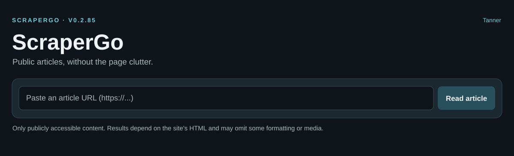

# ScraperGo



*ScraperGo's browser reading interface (illustrative preview).*

ScraperGo is a Go web-based clean article reader. Give it an article URL to extract readable text, headline, byline, inline links and editorial images into a simplified browser reading view. It distinguishes articles from many homepages/indexes, resolves supported Google News links, retains usable public previews where access policy permits, and offers image metadata, image delivery, classification and thumbnail APIs. Publisher restrictions and extraction limits remain in force; ScraperGo does not bypass paywalls.

## Requirements and running

Build from source with Go compatible with [go.mod](go.mod) (currently Go 1.23.2) and Git:

```bash
git clone https://github.com/richard-mauri/scrapergo.git
cd scrapergo
go test -count=1 ./...
go run . --port 8083
```

The default port without `--port` or `PORT` is 8080; the command-line flag overrides `PORT`. For a local macOS build use `./devbuild.sh` to create Intel and Apple Silicon binaries under `dist/` and checksums. The repository's `./scrapergo.sh` is **machine-specific**: it launches an Intel build at localhost:8083 plus a separately configured Cloudflare tunnel. It expects private local paths/tunnel credentials and is not a universal installation script. `./devbuild.sh --release` publishes a release; do not use it for normal builds.

Open http://localhost:8083/ after starting on that port; use the page to submit an article URL. For a Safari right-click link workflow, see [Safari extension setup](safari-extension/README.md). The temporary extension can target local or an independently reachable trusted HTTPS instance and reuses the reader tab.

## HTTP API

These routes are registered in [internal/app/server.go](internal/app/server.go); read, image-metadata and classification accept JSON. Examples below assume the server is running locally at 8083.

```bash
curl -sS -X POST http://localhost:8083/api/read \
  -H 'Content-Type: application/json' \
  -d '{"url":"https://example.com/article"}'

curl -sS -X POST http://localhost:8083/api/image-metadata \
  -H 'Content-Type: application/json' \
  -d '{"url":"https://example.com/article"}'

curl -sS -X POST http://localhost:8083/api/classify \
  -H 'Content-Type: application/json' \
  -d '{"url":"https://example.com/article"}'

curl -sS 'http://localhost:8083/api/article-image?url=https%3A%2F%2Fexample.com%2Farticle'
curl -sS 'http://localhost:8083/api/thumbnail?url=https%3A%2F%2Fexample.com%2Farticle&width=256' -o thumbnail.jpg
```

`POST /api/read` returns a normalized article JSON document or structured error; request body is limited to 4096 bytes. `POST /api/image-metadata` uses that same read path and returns `url`, `imageUrl`, `imagePresent` and ordered `imageCandidates`. `POST /api/classify` returns `classification`, `readableArticle`, `reason` and `imageAvailable` as appropriate; unknown/unavailable does not mean verified unreadable. `GET /api/article-image` serves a selected image; `GET /api/thumbnail` creates a cached, cropped JPEG (width subject to server validation).

Two developer diagnostics, `POST /api/diagnostic/extract` (requires `{"url":"...","html":"..."}`) and `POST /api/diagnostic/image-trace` (accepts `{"url":"..."}` and optional `html`), are **direct-loopback-only**, not public APIs. Keep them inaccessible to remote clients, including via any proxy that rewrites the apparent peer to loopback.

## Restrictions and limitations

Network article retrieval enforces public HTTP(S) URL and redirect restrictions to mitigate SSRF; some Google News and publisher URLs cannot be resolved. Subscriber-only, blocked, script-heavy, dynamically loaded or non-article pages may yield an error, public preview or incomplete text. Image availability, portrait versus editorial-role classification, and live-page compatibility vary by source. Retrieval and rendering are not a substitute for permission to view the original content. The synthetic regression fixtures do not establish coverage of all live publisher pages.

## Project references

[Architecture contract](ARCHITECTURE.md) · [Development and PR workflow](DEVELOPMENT.md) · [Agent instructions](AGENTS.md) · [Repository layout](docs/repository-layout.md) · [Extraction fixtures](docs/extraction-fixtures.md).
